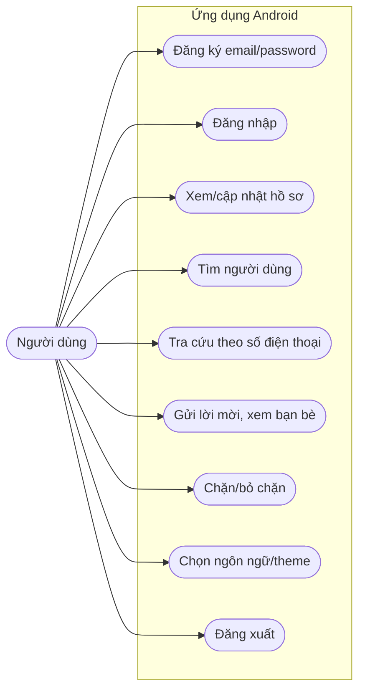
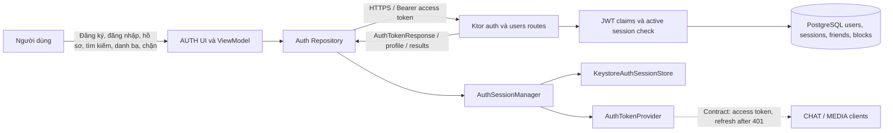

# AUTH D31–D35 Validation and Handoff

**Owner:** Đinh Công Huy (AUTH)
**Planned window:** D31–D35
**Branch:** `feature/auth-email`
**Scope:** AUTH regression/security checks, profile and permission coverage, test evidence, and the AUTH portion of the report.
**Status:** PARTIAL — local Android and Ktor test suites pass. OTP/provider, login throttling, PostgreSQL, device, cross-module integration, and the group's Word report remain unverified or incomplete.
**UI reference:** NOT VERIFIED. No Stitch screen was inspected for this validation/documentation task.

## Gate and freeze boundary

The plan says D31–D40 are for testing, fixes, documentation, and submission preparation. D31–D35 must not add new product features. E2EE and multiple accounts remain outside this release: the D26–D30 review marked both NO-GO, and no new approval is recorded here.

This document is an evidence ledger, not a claim that the group regression gate passed. The test counts below come from the D31–D35 Gradle runs recorded in this handoff. They do not establish PostgreSQL, device, CI, CHAT/MEDIA integration, or release-candidate behavior.

## Existing AUTH coverage found in source

| Area | Existing automated coverage |
|---|---|
| Android auth form/profile | `AuthViewModelTest.kt`: validation against backend rules; invalid login rejected before repository call; login/register success; invalid credentials; restored session; profile validation/update; successful logout; server/network logout failures. |
| Android session lifecycle | `AuthSessionManagerTest.kt`: expired access token refresh and rotation persistence; successful logout; server/network logout failure; expired refresh; unauthorized refresh with locally expired/revoked credentials; server-rejected refresh. |
| Android preferences | `AuthAppSettingsStoreTest.kt`: theme/language defaults, persistence, and system/VI/EN resolution. |
| Backend auth/session | `AuthRoutesTest.kt`: registration/login/refresh/logout/profile lifecycle, invalid credential response behavior, session checks, expiry, and database failure mapping. |
| Backend user privacy and contacts | `AuthRoutesTest.kt`: search pagination/privacy, phone discovery privacy with provider-verification metadata set directly by a test fixture, friend-request ownership, and block hiding/ownership. No OTP provider is exercised. |
| Application auth boundary | `ApplicationTest.kt`: private conversation access requires valid JWT; unauthenticated WebSocket rejection and message deduplication. |

Android ViewModel/session/settings tests use fakes or in-memory state. Ktor route tests use `InMemoryAuthRepository`; they do not establish PostgreSQL migration behavior, live HTTP/provider behavior, or that the app was exercised on a device.

## D31–D35 test and evidence matrix

| Day | Planned AUTH work from the group plan | Current evidence and known gap | D31–D35 outcome |
|---|---|---|---|
| **D31** | Regress OTP, email/password, logout, refresh, phone search, block, and multi-account if present. | Email/password (including duplicate email/username responses), logout, refresh, phone search, and block have automated route coverage. OTP/provider routes are not implemented because the provider has not been selected. Multi-account is NO-GO / not implemented. | **PARTIAL.** Android and backend regression suites passed. OTP and multi-account are **NOT APPLICABLE / NOT IMPLEMENTED**, not pass. |
| **D32** | Add auth/profile/permission unit or integration tests; fix blockers. | Android auth ViewModel tests now cover 401 login state, registration password clearing, invalid profile fields, and the 72-byte password boundary. Ktor coverage checks `/users/me` ownership across two accounts. Tests use fakes/in-memory repositories. No device evidence for runtime permission denial/recovery or rotation is recorded. | **PARTIAL.** Added cases and full local test suites passed; device permission and rotation behavior remain **NOT VERIFIED**. |
| **D33** | Check sensitive-data handling, unauthorized APIs, password/OTP throttling, and session. | Tests cover generic wrong-password/unknown-email responses, refresh rotation/reuse rejection, logout revocation, expiry, and protected-route behavior. Source review is not a captured-log or PostgreSQL test. OTP throttling is unavailable; a general login brute-force limiter is absent. | **PARTIAL.** Automated checks passed; throttling, PostgreSQL, and runtime secret/log behavior remain open or unverified. |
| **D34** | Write AUTH report section: requirements, use cases, authentication architecture, security, and contacts. | This handoff contains report-ready AUTH requirements, use-case and architecture diagrams, security limits, and contacts scope. The checkout contains no `.docx` report to update. | **PARTIAL.** AUTH source material is prepared here; the group's Word report still needs integration and review. |
| **D35** | Finish AUTH tests; refine illustrations and use-case diagram; prepare test evidence. | Android and backend Gradle commands passed and XML evidence is recorded below. The use-case diagram is included. No device capture, approved Stitch comparison, CI run, or group-wide RC2 result is available. | **PARTIAL.** AUTH local regression evidence is recorded; this does not establish the group's RC2 or Gate F. No product feature was added. |

## Regression cases to record

Record each row as PASS, PARTIAL, FAIL, NOT RUN, or NOT APPLICABLE / NOT IMPLEMENTED after checking the relevant evidence.

| Case | Expected behavior | D31–D35 result and evidence |
|---|---|---|
| Wrong password and unknown email | Both return the documented generic unauthorized response; no authenticated session is created. | **PARTIAL —** `registrationLoginRefreshLogoutAndProfileUseServerManagedSessions` checks equal status and response body for the two cases. It does not assert that no session row was created. Ktor in-memory route test. |
| Registration validation and duplicate account | Invalid values are rejected; duplicate email/username does not create another account. | **PARTIAL —** Android ViewModel validation tests pass; the Ktor lifecycle test checks duplicate email and username return `409`. It does not explicitly assert repository row count after the conflicts. Ktor in-memory route test. |
| Refresh rotation and reuse | Refresh rotates the credential once; old/reused/revoked credentials are rejected and locally expired credentials are cleared where appropriate. | **PARTIAL —** backend lifecycle test covers rotation, reuse rejection, and post-logout rejection; Android session tests clear locally expired credentials without calling the server. No backend test submits an already-expired refresh token to `/auth/refresh`. |
| Logout and revoked access | Successful logout revokes the server session and clears local credentials; failed logout keeps credentials for retry; revoked session cannot access protected routes. | **PASS —** Android session/ViewModel and backend lifecycle/expiry route tests passed. Ktor repository is in-memory. |
| Profile ownership and validation | Caller can update only their profile; invalid values fail validation; expired or missing credentials are rejected. | **PARTIAL —** `profileReadAndUpdateAreScopedToAuthenticatedUser` checks two-user isolation; Android invalid-profile tests pass; `expiredAccessTokenCannotReadPrivateProfile` checks an expired bearer token on `/users/me`. A missing-bearer `/users/me` request is not separately asserted. Ktor repository is in-memory. |
| Search and phone discovery privacy | Search does not reveal email/phone; phone lookup respects verified opt-in; unavailable/non-discoverable accounts are indistinguishable as specified. | **PARTIAL —** Ktor tests cover discoverable success and non-discoverable `404` with verification metadata populated by a fixture. They do not compare that `404` with a nonexistent phone; OTP/provider verification is not exercised. |
| Block ownership and visibility | Block hides the pair in AUTH search/lookup/friend results, cancels pending requests as contracted, and only the blocker can remove it. | **PASS for AUTH routes —** Ktor block test passed. CHAT message/WebSocket delivery still requires CHAT-side enforcement. |
| Sensitive data | Passwords are hashed server-side; refresh tokens are stored as hashes server-side; Android secrets use the Keystore-backed store; logs do not contain credentials or tokens. | **PARTIAL —** test suites pass and code paths were reviewed; no PostgreSQL, device/Keystore, or captured-log assertion was run in this window. |
| OTP | No production bypass; dev/test uses the chosen provider's sandbox/test mechanism and throttling. | **NOT APPLICABLE / NOT IMPLEMENTED —** provider is unselected and OTP routes do not exist. No fixed OTP or bypass was added. |
| Multiple accounts | Account data, cache, socket, and notification routing are isolated. | **NOT APPLICABLE / NO-GO —** no multi-account isolation implementation exists for this release. |

## AUTH use case and documented architecture

The flow below is derived from `docs/api-contract.md` and the AUTH sources. The CHAT/MEDIA token-provider edge is a contract boundary; their end-to-end integration remains pending per the prior handoff.

### AUTH use-case view

This diagram lists current AUTH use cases only; OTP and multi-account are excluded because they are not implemented.

### Report-ready summary

AUTH uses Kotlin/Jetpack Compose with MVVM and a repository boundary on Android, and Ktor routes backed by PostgreSQL on the server. Registration hashes passwords with BCrypt. Access JWTs identify both the user and session; protected requests validate the active session. Refresh credentials are opaque, stored server-side as hashes, and rotated; logout revokes the session. Android stores session credentials with the Keystore-backed encrypted store and exposes `AuthTokenProvider` as the shared contract for HTTP/WebSocket clients.

AUTH endpoints cover email/password registration and login, refresh/logout, the caller's profile, user search, phone discovery, friend requests, and blocks according to the current API contract. Search and relationship responses omit private email/phone fields; phone discovery requires provider-backed verification and opt-in. E2EE and multiple accounts are excluded from this release. OTP remains blocked because the group has not selected a provider. CHAT must still enforce block rules at message/WebSocket delivery, and CHAT/MEDIA must complete integration with the shared token provider before the group can claim those flows are end-to-end.

## D31–D35 execution record

- Android command, run from `android-app/`: `.\gradlew.bat testDebugUnitTest assembleDebug --rerun-tasks`
  - Result: **PASS** (`BUILD SUCCESSFUL`; unit tests and `assembleDebug` completed).
  - Unit test count: **52 passed, 0 failures, 0 errors, 0 skipped** across 8 XML suites. This is the full Android unit-test task, not 52 AUTH-only tests.
  - Run date/time: **2026-11-14 13:28 ICT** (XML suite timestamps 06:28:47–49 UTC); tested at base `HEAD cf6e3ba` plus the uncommitted AUTH test changes.
  - Evidence: `android-app/app/build/test-results/testDebugUnitTest/` and `android-app/app/build/reports/tests/testDebugUnitTest/`.
  - Debug APK produced at `android-app/app/build/outputs/apk/debug/app-debug.apk` (last write 2026-11-14 13:28:44 local). It was not installed or exercised on a device.
- Backend command, run from `backend/`: `.\gradlew.bat test --rerun-tasks`
  - Result: **PASS** (`BUILD SUCCESSFUL`).
  - Test count: **12 passed, 0 failures, 0 errors, 0 skipped**: 3 `ApplicationTest` cases and 9 `AuthRoutesTest` cases.
  - Run date/time: **2026-11-14 13:34:54–13:34:58 ICT** (XML suite timestamps 06:34:54 and 06:34:58 UTC); includes the duplicate-email/username assertions in the working tree, with base `HEAD cf6e3ba`.
  - Evidence: `backend/build/test-results/test/` and `backend/build/reports/tests/test/`. All auth route tests use `InMemoryAuthRepository`; the suite did not connect to PostgreSQL.
  - Compiler emitted existing Kotlin serialization opt-in warnings in `backend/.../auth/AuthModels.kt`; the task completed successfully.
- PostgreSQL migration/integration evidence: **NOT VERIFIED**; this run used in-memory route repositories and no `DB_URL`.
- Device rotation, runtime permission denial/retry, and Keystore persistence evidence: **NOT VERIFIED**; no device run was recorded.
- CI result: **NOT RUN / NOT RECORDED** in this worktree.
- D31–D35 AUTH Gate status: **PARTIAL** — local Android and backend regression suites pass; OTP/provider, login throttling, PostgreSQL, device evidence, cross-module enforcement/token integration, and the group's DOCX/RC2 remain incomplete or unverified.

## Open gaps and integration dependencies

The following local QA IDs are for the D31–D35 handoff; they do not represent issues filed in an external tracker.

| Local ID | Severity / status | Owner | Gap / next action |
|---|---|---|---|
| AUTH-D31-01 | HIGH / OPEN before public deployment | AUTH + deployment owner | No general login brute-force rate limiter. Choose a deployment-wide/shared enforcement point and test it before exposing login publicly. |
| AUTH-D31-02 | BLOCKED | AUTH + group | OTP provider is unselected and request/verification routes are unimplemented; select provider before implementing or testing OTP throttling. |
| AUTH-D31-03 | NOT VERIFIED | AUTH | Test auth/profile/settings rotation and runtime permission denial/recovery on a real Android device. |
| AUTH-D31-04 | OPEN / cross-module | CHAT | Enforce AUTH block state for direct-message and WebSocket delivery before claiming end-to-end blocking. |
| AUTH-D31-05 | OPEN / cross-module | CHAT + MEDIA | Integrate the shared `AuthTokenProvider` in CHAT WebSocket and MEDIA HTTP/call/push flows. |

1. The OTP provider and request/verification implementation are unselected/unimplemented; OTP rate limiting cannot be validated yet.
2. The backend has no general login brute-force rate limiter. Track this as a security gap; do not claim D33 throttling passed.
3. PostgreSQL migrations and database-backed authorization were not validated by the in-memory Ktor route tests recorded in the prior handoff.
4. Android runtime permissions, rotation, Keystore behavior, and screen-level error/retry behavior need device evidence.
5. CHAT must enforce block checks for message and WebSocket delivery. MEDIA and CHAT must integrate the shared `AuthTokenProvider` before cross-module auth can be called end-to-end.
6. No settings-sync endpoint is documented; theme/language persistence is local.
7. E2EE and multi-account remain NO-GO for this release.

## References and disclosure

- `AGENTS.md` §§0–12 and §16: evidence, ownership, freeze, security, and reporting rules.
- `ke_hoach_40_ngay_android_chat_kotlin.md` §4: D31–D35 assignments and D31–D40 quality period.
- `docs/requirements/rubric_vn.pdf`: source, report, APK, screenshot, and actual unit-test expectations.
- `docs/api-contract.md`: AUTH session, user, contacts/block, and shared token-provider contracts.
- `docs/auth-security-d26-d30.md`: previous freeze review and unresolved security/integration gaps.
- Android AUTH tests and `backend/src/test/kotlin/vn/edu/hcmute/androidchat/backend/AuthRoutesTest.kt`: current automated coverage.

**AI disclosure:** AI assisted preparation of this validation matrix and report text. The AUTH owner must review the document and be able to explain the implementation and evidence.
