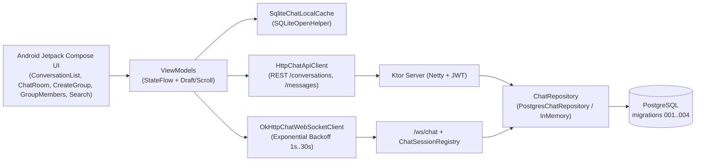
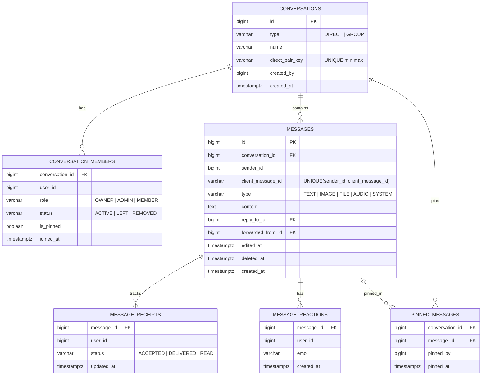
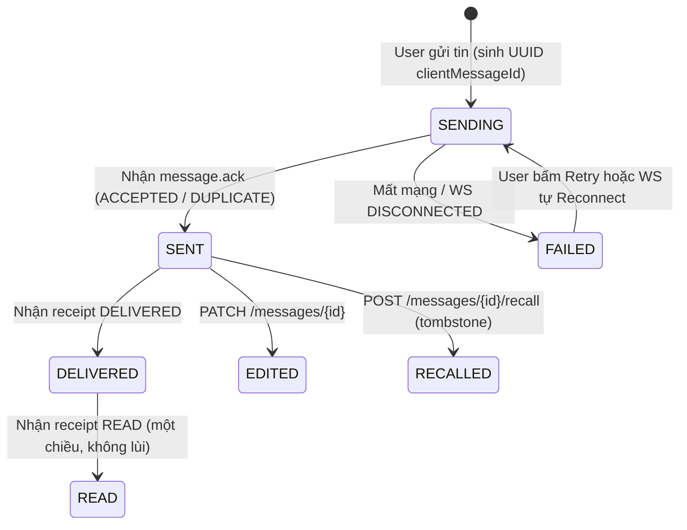

# Tài liệu tổng hợp & bàn giao module CHAT (D36–D40)

- **Phụ trách:** Xuân Hoàng (`xuanhoangtr`) — Module CHAT
- **Nhánh:** `feature/chat-realtime` (worktree `wt-chat`)
- **Tham chiếu:** `ke_hoach_40_ngay_android_chat_kotlin.md` (§4 D36–D40), `docs/api-contract.md`, `docs/chat-d31-d35-report.md`

---

## 1. D36 — Kiến trúc tổng thể, ERD & Biểu đồ trạng thái

### 1.1. Kiến trúc tổng thể (Android + Ktor + PostgreSQL)



### 1.2. ERD cơ sở dữ liệu module CHAT



### 1.3. Biểu đồ trạng thái vòng đời tin nhắn (Message Lifecycle & Reconnect)



---

## 2. D37 — Dàn ý Slides & Kịch bản Demo phần CHAT (trong khung 8–12 phút)

### 2.1. Dàn ý Slides (phần Xuân Hoàng — ~3–4 phút)
1. **Slide 1 — Kiến trúc Realtime CHAT:** Ktor WebSocket (`/ws/chat`), khung gói tin chuẩn `WsEnvelope`, `ChatSessionRegistry` đa phiên theo `userId`.
2. **Slide 2 — Chống trùng & Đồng bộ Offline/Reconnect:** Cơ chế `clientMessageId` idempotent ở DB + ACK (`ACCEPTED`/`DUPLICATE`) + `SqliteChatLocalCache` + exponential backoff `1s → 30s`.
3. **Slide 3 — Chat Nhóm & Tương tác nâng cao:** Tạo nhóm, phân quyền `OWNER`/`ADMIN`/`MEMBER`, chặn thành viên bị xóa tức thời ở cả REST & WS, Reply/Forward/Edit/Recall/Reaction/Search/Pin.

### 2.2. Kịch bản Demo trực tiếp (~4 phút cho CHAT)
1. **Chat 1–1 realtime (2 máy A & B):** A gửi tin cho B → hiện `Đang nhập...` (typing) → B nhận ngay lập tức → trạng thái chuyển `Đã gửi → Đã nhận → Đã xem` (read receipt).
2. **Chứng minh Reconnect & Idempotency:** Tắt Wi-Fi máy A → gửi tin (hiện `FAILED` có nút thử lại) → bật lại mạng → WS tự reconnect, gửi lại cùng `clientMessageId`, không tạo tin trùng.
3. **Tương tác tin nhắn:** B trả lời (Reply) tin của A → bấm vào khung Reply để nhảy tới tin gốc → thả emoji Reaction → A sửa tin (Edit) và thu hồi 1 tin (Recall).
4. **Chat nhóm (3 người A, B, C):** A tạo nhóm 3 người → xóa C khỏi nhóm → chứng minh C không thể đọc lịch sử hay gửi tin mới vào nhóm nữa.
5. **Tìm kiếm & Xoay màn hình:** Tìm kiếm theo từ khóa (tin thu hồi không xuất hiện) và xoay ngang màn hình khi đang soạn nháp để chứng minh không mất `draft` và vị trí cuộn.

---

## 3. D38 — Checklist Dry-run Demo 1 (Module CHAT)

| STT | Hạng mục kiểm tra | Trạng thái hiện tại | Ghi chú thực địa |
|---|---|---|---|
| 1 | Backend Ktor compile & chạy unit/integration tests (`./gradlew.bat test`) | **PASS** (JVM/Ktor) | Chạy được ngay không cần DB ngoài |
| 2 | Android debug APK compile & unit tests (`testDebugUnitTest assembleDebug`) | **PASS** (JVM/APK) | Đã fix cấu hình IPv4 Gradle |
| 3 | Chạy backend với PostgreSQL thật (`DB_URL` + migrations `001`–`004`) | **NOT RUN** | Cần chạy khi chuẩn bị máy demo |
| 4 | Test 2 thiết bị thật: Chat 1–1, typing, presence, read receipt | **VISUAL_UNVERIFIED** | Thực hiện cùng Đinh Công Huy & Nguyễn Quang Huy |
| 5 | Test 3 thiết bị thật: Nhóm, xóa thành viên, chặn REST/WS ngay | **VISUAL_UNVERIFIED** | Thực hiện khi ghép nhánh `main` |
| 6 | Quay video fallback demo dự phòng sự cố mạng phòng thi | **PENDING** | Quay sau khi ghép bản tích hợp `main` |

---

## 4. D39–D40 — Rà soát đóng gói, bảo mật & Rubric nộp bài

### 4.1. Checklist bảo mật & vệ sinh repository (D39)
- [x] Không commit `local.properties`, keystore (`.jks`/`.keystore`), file `.env` thật, hay thư mục `build/`.
- [x] `backend/.env.example` chỉ chứa placeholder mẫu, không chứa mật khẩu/JWT secret production.
- [x] Không có API key hoặc credential hardcode trong mã nguồn Kotlin.
- [ ] Khi ghép đủ 3 module vào `main` và hoàn tất dry-run trên máy thật: tạo tag `v1.0-final` và nén ZIP giữ nguyên `.git`.

### 4.2. Lệnh kiểm tra nhanh trước khi đóng gói (D40)

```powershell
# 1. Kiểm tra git sạch, không chứa file nhạy cảm
git status --short

# 2. Chạy toàn bộ test Backend
cd backend
.\gradlew.bat test --no-daemon

# 3. Chạy unit test & build APK Android
cd ..\android-app
.\gradlew.bat testDebugUnitTest assembleDebug --no-daemon "-Djava.net.preferIPv4Stack=true"
```
